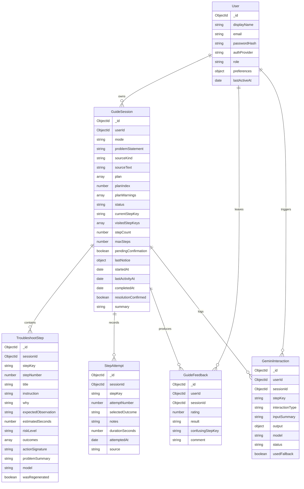

# UnStuck

**One step at a time until it works.**

UnStuck hands you **one instruction at a time**, asks what actually happened, and decides what comes
next from your answer. There are two ways in, and neither of them is only for computers:

1. **Something is broken.** Describe the problem in your own words and the app writes each step for
   you, at the moment you answer. If something fails, it is remembered and never suggested again.
2. **You already have the instructions.** Hand them over as a photo, as pasted text, or by saying
   them out loud — a flat pack manual, a recipe, a medicine leaflet, a bank letter, a sewing
   pattern — and they come back one step at a time.

---

## Who this is for

This is built for two kinds of people:

1. **People who are not comfortable with technology.** They know something is broken but not what
   it is called or how to search for it. They type *"my wifi is not working"*, not
   *"802.11 association failure"*.
2. **People who are comfortable, but are tired of the tab chaos.** Solving a small problem usually
   means opening 10–20 browser tabs, skimming long articles full of steps that do not apply,
   scrolling past adverts, and still not knowing which instruction fixed it.

Most troubleshooting content is written as a long static article. It assumes you will follow every
step in order and that each one works. Real life is not like that: step three fails, and now you
are on your own.

**This app builds the instructions for you, one at a time, from your own description of the
problem.** It shows one action, waits for what you observed, and writes the next move from that. It
also keeps a record of everything already tried, so nothing gets repeated and nothing gets lost if
you come back later. And when the instructions already exist — a manual, a leaflet, a letter — it
does the other half of the job: it reads them once and then hands them over in the same
one-step-at-a-time way.

---

## The two workflows

| | **Diagnose** (`mode: "dynamic"`) | **Read instructions** (`mode: "explain"`) |
| --- | --- | --- |
| You start by | Describing a problem | Handing over instructions |
| Where the steps come from | Written by the model, one at a time | Read out of your own instructions, once |
| When the model is called | Every step | Once for the whole set, and again only if a step does not work out |
| How you answer | The outcomes the model expects, plus two the server adds | "Done, what is next" / "I could not do this step", plus two the server adds |
| How it ends | You confirm whether the problem is fixed | You confirm whether you got to the end |
| What it costs | One request per step | One request per set of instructions |

Both modes share the same session machinery, the same safety guard, the same history, the same
**My sessions** list, and the same honest escalation. They differ in where the steps come from, not
in how they are trusted.

---

## How the app works

The steps below walk through the **diagnose** flow, which is the one that starts from nothing. The
reading flow follows the same shape — one step, one answer — but its answers are simpler and its
steps come from your own instructions. That difference is described in
[Reading instructions you already have](#reading-instructions-you-already-have).

### 1. Describe the problem
You type the problem in your own words into one box: *"my laptop sees the headphones but will not
connect"*. That sentence is the only thing you write. Every later step is generated from it.

### 2. Start a session
A **session** is your run at one problem. You need an account: there is no anonymous mode, because a
session always belongs to a real user and is listed under **My sessions**. The moment the session
starts, the first step is generated before anything is shown, so you land on a real instruction
rather than an empty screen.

### 3. One step at a time
You see exactly one instruction, why it matters, and what you should expect to see. Nothing else.
There is no long list to scroll, and no step that assumes the previous one worked.

### 4. Report the outcome — including "Something else happened"
Every step offers the realistic answers, plus two the server always adds:

- **That fixed it** — you think the problem is gone.
- **Something else happened** — none of the options matched what you saw.

The app never forces you to pick a fake answer just to move forward. "Something else happened" is a
first-class path: it is fed back to the model as *"ask a short clarifying question, or escalate"*.

### 5. The next step is written from your answer
Your answer, the full list of steps already shown, and which answer was given to each one are all
sent to Gemini. It replies with exactly one next step — never a list, never a whole guide.

### 6. Memory of failure
This is the core idea of the product, and it is enforced on the server, not asked for politely.

Every instruction shown is reduced to a normalised "action signature". Before a new step is shown,
it is compared against every signature already tried. If it is too similar — the threshold is 0.6 on
a word-overlap score — it is rejected, even if it is worded completely differently. The model is
told the specific reason and asked once more. It does not get to walk you back into something that
already failed.

### 7. Confirm the ending
"That fixed it" is **your** claim, not the app's conclusion. It does not mark anything as solved; it
puts the session into a confirmation state and asks you directly. Only you can mark a session as
resolved. If you say no, the session ends as unresolved and everything you tried is kept.

### 8. Leave feedback (optional)
A short form lets you say whether it solved the problem, how clear it was, and which step was
confusing. It is stored against the session, for the record.

---

## Reading instructions you already have

This is the second workflow, and it is a different job from diagnosing.

When the model *writes* a step, the risk is that it invents something. When the model *reads*
instructions, the risk is the opposite one: it adds a step that was never there, or quietly drops a
warning that mattered. So it is prompted hard on staying faithful to the original, and everything
it returns is checked again on the server.

### Where the input comes from

All three arrive at the same box and go up the same route:

- **A photo** of the page. Sent as base64 alongside the prompt in one call — Gemini reads the picture
  and the text together. Only PNG, JPG and WebP are accepted, up to 4 MB, and HEIC is deliberately
  refused with a plain message rather than sent and failing confusingly.
- **Pasted text**, up to 6000 characters. Line breaks are preserved, because someone pasting a
  numbered list is handing over structure and flattening it would throw that away.
- **Speech**, through the browser's own speech API. It lands in the same text box. If the browser
  does not have that API, the button is simply not shown.

A photo wins if both arrive, because photographing a page is the more deliberate of the two. A photo
is read once and then discarded: it is never written to the database. Only text the user typed is
kept, so the session can show what it was working from.

### What comes back, and what is thrown away

The model returns a short plan: a subject line and up to 10 steps, in the original order.

Unlike a generated step, **a bad plan is not thrown away whole**. A ten step leaflet with one unsafe
line should still help with the other nine, so the bad step is dropped and the rest is kept — with a
visible warning saying what was left out and why. The rules about anything (see below) apply to a
recipe exactly as they apply to a device. Nothing is ever removed silently.

If nothing survives, the whole thing is refused and the user is told, rather than shown an empty
screen.

### Cost

The plan is saved with the session and then handed over **one step at a time from the database**.
Getting through a six-step set of instructions costs **one** model request, not six. The model is
only asked again when a step does not work out and the written instructions have run out of
usefulness — that is the "I could not do this step" path, and it is the only time this mode spends
another request.

This matters because of the free tier: 20 requests per day, **per model**. A workflow that re-read
the same leaflet for every step would exhaust that in three sessions.

---

## The three principles behind it

| Principle | What it means in the code |
| --- | --- |
| **The model proposes, the engine disposes** | Gemini writes every step, but nothing reaches the user until `dynamicEngine.js` has accepted it. Shape, risk and repetition are all decided on the server. |
| **Memory of failure** | Every shown step is stored with an `actionSignature`. A new step too similar to any of them is rejected and regenerated, so a failed action is never suggested twice. |
| **Honest recovery** | When the safe options run out — or the model cannot help — the session ends as `escalated` with a plain explanation. It never fakes a fix, and it never shows a step that failed validation. |

---

## Where the AI fits now

Gemini is **the engine, not a helper**. In the diagnosing flow it writes the instruction itself,
which is the product feature. There is no rule-based stand-in for a real diagnosis, so when the key
is missing the app says so and stops.

Four things call the model:

- **Generate the next step** — the core feature of the diagnosing flow. One instruction, plus the
  answers it expects.
- **Read a set of instructions** — the core feature of the reading flow. One photo or one block of
  pasted text in, one short plan out.
- **Explain a step differently** — rewrite the current instruction in simpler words. The *action*
  is never changed. This one *does* have a deterministic fallback, because rewriting text you
  already hold is not a diagnosis.
- **Summarise a session** — write up what was tried. It also falls back to a plain summary built
  from the records.

### The four checks every generated step passes

This is the whole point of the design, and it all happens in
[`dynamicEngine.js`](file:///Users/avishkarwagh/Desktop/UnStuck/server/src/services/dynamicEngine.js),
on the server, where the model cannot reach it:

1. **Shape.** Malformed output is thrown away, not repaired. Titles, instructions and outcomes are
   trimmed and length-capped, duplicate outcome keys are dropped, and any outcome key starting with
   `__` is stripped — those belong to the server.
2. **Risk.** This is checked in two layers, because the app has two jobs:
   - **Rules about anything** (`FORBIDDEN_ANY`), which apply in *both* modes: mixing bleach and
     ammonia, mains electricity, changing a medicine or its dose, stopping a prescription, gas
     leaks, naked flames, protective wiring, ignoring a safety warning, working at height, and
     checking food safety by taste or smell.
   - **Rules about devices** (`FORBIDDEN_DEVICE`), which apply only to steps the app wrote itself,
     where the subject really is a machine: command lines, administrator rights, deleting or
     resetting data, uninstalling/reinstalling, weakening security, registry/BIOS/firmware,
     opening hardware, installing unknown software, and asking for private information.

   The split is not cosmetic. A recipe that says *"wipe the bowl"* or a form that says *"delete the
   old entry"* is not a data-loss risk, and blocking it would be nonsense. Mixing bleach is
   dangerous whoever suggested it. The model may also only ever claim `risk_level: "low"`; claiming
   anything higher is treated as a refusal.
3. **Repetition.** The action signature is compared against everything already shown. Too similar,
   and it is rejected.
4. **Room left.** After `MAX_SESSION_STEPS` steps the engine stops and escalates rather than going
   round in circles.

The model gets **two attempts** at a step. If both fail, the session escalates with an honest
message naming the reason. Nothing invalid is ever shown.

### The outcomes the model is not allowed to write

`__fixed` and `__something_else` are appended by the server *after* validation, so every single
step offers a way out. The model is told not to include them, and if it does, they are stripped.

The **wording** of those two depends on the mode, because "that fixed it" is right for a broken
laptop and wrong for a recipe:

| Session | `__fixed` | `__something_else` |
| --- | --- | --- |
| `dynamic` | That fixed it | Something else happened |
| `explain` | That is everything, thank you | This step is not working out |

The same applies to the choices on a plan step, which are written by the server
(`PLAN_OUTCOMES`) rather than by the model, so every plan step is worded the same way.

### If there is no API key

The app **refuses honestly**. A session that cannot generate a step ends as `escalated` with the
message:

> This app needs an AI key on the server, and none is configured right now. Nothing has been
> invented to fill the gap.

This is deliberate. A fake step would be worse than no step.

### Busy, or out of quota — two different things

A failed call is not treated as one kind of failure, because the correct response is different:

- **Transient ("busy").** The service is briefly overloaded. The call is retried, and if it still
  fails the session is put into a **busy** state, not an escalated one: nothing is lost, the same
  step is offered again, and the message says to wait a moment rather than that the app has given up.
- **Daily quota, which is terminal.** The free tier really has run out for the day. This is detected
  from the error itself — a 429 that names a per-day limit — and it is **never retried**, because
  retrying a limit you have already hit only burns the requests you have left. The user gets a plain
  message saying the daily allowance is used up and that their session is safe, instead of the
  misleading "busy, try again".

Collapsing those two into one "busy" message is exactly the bug that makes an app look broken when
it is not, so they are kept apart end to end: the service classifies the failure, and the state the
session lands in reflects it.

---

## Tech stack

- **Frontend** — React 18 (Vite), React Router, Tailwind CSS, Axios
- **Backend** — Node.js, Express, MongoDB with Mongoose, JWT (HttpOnly cookie)
- **AI** — Gemini via REST (`v1beta`, JSON response mode, scrubbed input, and every call logged).
  Each call has its own hard abort timeout and retry count: a step gets 9s and up to 3 tries, reading
  a set of instructions gets 20s and 2 tries, and the two assist calls get 8s and 2 tries. If the API
  rejects a request, the status and reason are printed to the server log rather than swallowed,
  because otherwise a wrong model name looks like an unreadable reply. A **daily** quota error (429)
  is never retried — retrying a limit you have already hit just burns time — while a transient one is
  retried within that budget.
- **Database** — local MongoDB, or an automatic in-memory MongoDB when `MONGO_URI` is empty

---

## Getting started

### Requirements
- Node.js 18 or newer (the step generator uses global `fetch`)
- MongoDB **is optional** (see below)
- A Gemini API key **is required** for the app to do anything useful

### Install

```bash
npm run install:all
```

### Configure

Copy `server/.env.example` to `server/.env`. Then set `GEMINI_API_KEY`.

```env
PORT=5050
JWT_SECRET=unstuck_dev_secret_change_me
MONGO_URI=
CLIENT_ORIGIN=http://localhost:5173
GEMINI_API_KEY=
GEMINI_MODEL=gemini-3.5-flash-lite
```

**Get a key from [Google AI Studio](https://aistudio.google.com/app/apikey).** It belongs in
`server/.env` only. Never put it in the client, never prefix it with `VITE_`, and never commit it.

**Picking a model matters more than it looks.** The free tier gives 20 requests per day **per
model**, and each model has its own allowance. So the default here is a lite model rather than a
full one: a diagnose session spends one request per step, and 20 shared with a heavier model
disappears quickly. If one model's daily limit is reached, switching `GEMINI_MODEL` to another gets
a fresh 20 without touching anything else. Retired models (the `gemini-2.0` line) return 404 and
must not be used.

**Leaving `MONGO_URI` empty is a feature.** The server then starts a temporary in-memory MongoDB and
is immediately usable — perfect for a demo or a viva with no setup. Data is wiped when the server
stops. Set `MONGO_URI` to a real instance when you want it to persist:
`mongodb://127.0.0.1:27017/unstuck`.

### Run

Open two terminals:

```bash
# terminal 1 — API on http://localhost:5050
npm run dev:server

# terminal 2 — app on http://localhost:5173
npm run dev:client
```

The server prints, on boot, whether the step generator is available:

```
[server] listening on http://localhost:5050
[server] database mode: memory
[server] step generator: enabled (Gemini)
```

Then open **http://localhost:5173** — you land on the landing page. Create an account (or sign in)
and the app opens at `/app`.

> Port 5050 is used instead of 5000 because macOS AirPlay already listens on 5000.

### Handy scripts

| Command | What it does |
| --- | --- |
| `npm run install:all` | Installs both server and client dependencies |
| `npm run dev:server` | Starts the Express API with file watching |
| `npm run dev:client` | Starts the Vite dev server |

---

## Data model (ERD)

Six collections. A `GuideSession` is the thread of one person working on one problem. The steps
themselves live in `TroubleshootStep`, not embedded in the session, so a session stays small no
matter how long the conversation gets.



### Why the steps are a separate collection

There are three reasons, and all three matter:

- **Refreshing must not cost a request.** A generated step is saved the moment it is shown. Reload
  the page and you get the same step back, read from the database. The model is not asked again.
- **Loop detection needs the full list.** `actionSignature` is stored per step precisely so the next
  generation can be compared against everything already shown.
- **A long conversation must not bloat one document.** Steps and answers grow without limit, so they
  get their own collections.

`GuideSession` holds only the thread: the problem as the user typed it, where they are now, and
where they have been.

### The fields only an explain session fills

Five of those fields are empty on a diagnose session and only used when the user hands over
instructions:

- **`sourceKind`** — whether the instructions arrived as `text` or as a `photo`, so the page can say
  where the steps came from. There is no third value; speech lands in the text box.
- **`sourceText`** — the pasted text, kept exactly as given so the session can show what it was
  working from. A **photo session leaves this empty on purpose**: the image is read once and then
  discarded, so there is no copy of the page sitting in the database.
- **`plan`** — the steps read out of the instructions, in order. This is the one place where the
  steps do *not* live only in `TroubleshootStep`: the plan is stored whole at reading time, and its
  steps are copied across one at a time as the user reaches them.
- **`planIndex`** — how far through the plan the user has got. It is kept separate from `stepCount`,
  because `stepCount` also counts steps the model writes later, when a plan step does not work out.
- **`planWarnings`** — the steps that were dropped from the plan, and the reason for each. Keeping
  them here is what lets the page say *what* was left out instead of quietly showing a shorter list.

Each `plan` entry is deliberately the **same shape** as a `TroubleshootStep`, so nothing downstream
can tell a step read from a leaflet apart from a step the model wrote. They take the same route
through the interface, the history and the guard.

---

## How a step is decided

The two modes take different routes to the next step. Both are listed here, because the difference
between them is the clearest way to see what each mode actually costs.

### Diagnose (`mode: "dynamic"`)

When the user reports an outcome, this is the whole flow, in order:

```
1. The answer must be one the user was actually offered on this step.
   → Not valid?  400 OUTCOME_NOT_FOUND

2. Record the StepAttempt (attempt number, outcome, timestamp).

3. If the outcome is "__fixed":
   → pendingConfirmation = true. Stop. Only the user can call it solved.

4. Otherwise, load every step and every attempt for this session.

5. Send the model: the problem, the full history with the answer given to each
   step, and an explicit "do not suggest any of these again" list.

6. Validate the reply (up to 2 attempts):
   shape      → malformed?      ask again
   risk       → blocked action? ask again, naming the reason
   repetition → too similar?    ask again, naming the reason
   → still failing after 2? escalate honestly, show nothing

7. The model may also answer "escalate" itself. That is taken at face value,
   not pushed back on.

8. Append the two system outcomes, save the step, return the new state.
```

Step 6 is the "model proposes, engine disposes" principle made real. The model is a suggestion
engine; the decision belongs to the server.

### Read instructions (`mode: "explain"`)

The plan was already read out of the user's own instructions when the session started, so the
common case here **does not call the model at all**:

```
1. The answer must be one of the two the server put on a plan step
   ("Done, what is next" / "I could not do this step").

2. Record the StepAttempt.

3. If the outcome is a plan step answered "done":
   → serve the next entry straight out of session.plan. No model call.
   → plan finished?  pendingConfirmation = true with a "that was the last
     step" notice. Reaching the end is not the same as success, so the
     user is still asked to confirm.

4. If the outcome is "could not do this step" (or the system's
   "__something_else"), the written instructions have run out of
   usefulness. Only now is the model consulted, with a note saying the
   plan step did not work, and it writes one fresh step.

5. If the outcome is "__fixed" ("that is everything, thank you"):
   → pendingConfirmation = true, exactly as in diagnose mode.
```

That asymmetry is the point of the design, not an optimisation: a plan is a fixed set of
instructions the user already owns, so re-reading it would be waste. The model is reserved for the
one case where it can actually add something — a step that did not work out.

---

## API reference

Base URL `/api`. The Vite dev server proxies `/api` to `http://localhost:5050`.

### Health

| Method | Path | Description |
| --- | --- | --- |
| `GET` | `/health` | Database mode and whether the step generator is configured. |

### Auth

| Method | Path | Description |
| --- | --- | --- |
| `POST` | `/auth/register` | Create an account. Sets the HttpOnly JWT cookie. |
| `POST` | `/auth/login` | Sign in. Sets the HttpOnly JWT cookie. |
| `POST` | `/auth/logout` | Clears the cookie. |
| `GET` | `/auth/me` | Current user. Requires auth. |

### Sessions (all require auth)

| Method | Path | Description |
| --- | --- | --- |
| `POST` | `/sessions` | Start a diagnose session and generate the first step. Body: `{ problem }`. |
| `POST` | `/sessions/explain` | Start a session from instructions you already have. Body: `{ text }` or `{ image }` (base64), never both. Reads them once and returns the first plan step. |
| `GET` | `/sessions` | List every session on your account. |
| `GET` | `/sessions/:id` | Full renderable state: current step, path, attempts. Never calls the model. |
| `POST` | `/sessions/:id/attempts` | Report an outcome. Body: `{ outcomeKey, notes?, durationSeconds? }`. |
| `POST` | `/sessions/:id/back` | Step back one step. |
| `POST` | `/sessions/:id/pause` | Pause the session. |
| `POST` | `/sessions/:id/resume` | Resume a paused session. |
| `POST` | `/sessions/:id/resolve` | Confirm the result. Body: `{ resolved: boolean }`. |
| `POST` | `/sessions/:id/abandon` | Stop and keep the record. |
| `POST` | `/sessions/:id/feedback` | Submit feedback. Body: `{ rating?, result, confusingStepKey?, comment? }`. |

### AI assist (rate limited to 20/min per user)

| Method | Path | Description |
| --- | --- | --- |
| `POST` | `/assist/explain` | Rewrite the current step more simply. Falls back deterministically. |
| `POST` | `/assist/summarize` | Summarise the session so far. Falls back deterministically. |

There is no endpoint for generating a step. That happens inside `POST /sessions`,
`POST /sessions/explain` and `POST /sessions/:id/attempts`, so the user can never ask for a step
that skips the guard. `/sessions/explain` is declared **before** `/sessions/:id` in the route table
on purpose: otherwise Express would read `explain` as a session id.

---

## Authentication

Every session route is behind `requireAuth`, and ownership is checked again inside the handlers:

- A JWT is stored in an **HttpOnly cookie** (`unstuck_token`), so browser scripts cannot read it. A
  `Authorization: Bearer` header is also accepted for tooling.
- The user id is always read from the decoded token. It is **never** taken from the request body.
- `GET /sessions/:id` compares the session's `userId` with the token's user and returns **403** for
  anything else, so guessing an id gets you nothing.
- If a token expires mid-use, any request that answers **401** fires a single global event, the
  client clears the stored JWT and the user is dropped back on the sign-in screen.

Because there is no guest path, `GuideSession.userId` is `required` at the schema level — a session
that is not owned by an account cannot exist in the database at all.

---

## Pages and routes

The app is split into a public zone and a private zone.

| Route | Zone | What it is |
| --- | --- | --- |
| `/` | Public | The landing page. Explains the problem, who it is for, how a session goes, and what the model is and is not allowed to do. |
| `/login` | Public | Sign in / create an account, on one screen with two tabs. |
| `/app` | Private | The app itself: two tabs — describe a problem, or hand over instructions. |
| `/session/:id` | Private | The live session, one step at a time. The same page serves both modes and adapts its wording. |
| `/history` | Private | **My sessions**, grouped per account, with a badge on sessions that came from instructions. |

Private routes render through `ProtectedRoute`, which remembers the page you wanted and sends you
back there after signing in. Because the public zone never needs a token, the landing page cannot
break for a signed-out visitor.

---

## Project structure

```
UnStuck/
├── package.json                 root helper scripts
├── server/
│   ├── .env / .env.example
│   └── src/
│       ├── index.js             binds the port, connects the DB, reports AI status
│       ├── app.js               express app, CORS, cookie parser, routes
│       ├── config/
│       │   ├── db.js            real MongoDB or automatic in-memory fallback
│       │   └── constants.js     every enum, MAX_SESSION_STEPS, MAX_PLAN_STEPS,
│       │                        the system outcomes and the per-mode labels
│       ├── models/              User, GuideSession, TroubleshootStep, StepAttempt,
│       │                        GuideFeedback, GeminiInteraction
│       ├── services/
│       │   ├── dynamicEngine.js        THE guard: shape, both risk blocklists,
│       │   │                           action signatures, repetition, system
│       │   │                           outcomes, and plan validation
│       │   ├── dynamicSessionService.js the orchestrator: one step request, up to
│       │   │                           2 attempts, escalation when it fails,
│       │   │                           and the plan-reading explain flow
│       │   ├── sessionService.js       persistence + rendering, no model calls
│       │   └── geminiService.js        the Gemini REST call, prompts, scrubbing, logging
│       ├── controllers/         auth, session, assist
│       ├── routes/              route tables
│       └── middleware/          auth (JWT), error handler, rate limit
└── client/
    └── src/
        ├── App.jsx              routes: public zone + protected zone
        ├── services/            api client, session store, formatters
        ├── context/             AuthContext
        ├── hooks/               useSession — session network calls
        │                        useVoice   — speech input, shared by both input boxes
        ├── components/
        │   ├── layout/          Layout, Header, Footer, StatusMessage, ProtectedRoute
        │   ├── instructions/    InstructionForm — photo / text / speech input
        │   ├── session/         StepCard, OutcomeButtons, ProgressBar, RecoveryNotice,
        │   │                    AttemptTimeline, SomethingElsePanel, ResolutionPanel,
        │   │                    ExplainPanel
        │   └── feedback/        FeedbackForm
        └── pages/               Landing, LoginPage, Home, SessionPage, HistoryPage,
                                 NotFound
```

The split between `dynamicSessionService` and `sessionService` is deliberate: the orchestrator needs
to call the model, and the persistence layer needs the guard to compute signatures. Keeping them
apart is what stops that becoming an import cycle.

---

## Limits and cautions

These are real, and they are stated rather than hidden:

- The model gets **two attempts** per step and a session ends after **12 steps**. Both are
  server-enforced, not requested. A plan read from the user's own instructions is capped at **10
  steps** and pasted text at **6000 characters**.
- The risk blocklists are **pattern matching**. Between them they cover nineteen categories — nine
  about devices, ten about anything — and they can be fooled by wording they have not seen. They are
  a safety net, not a guarantee.
- The model can be **confidently wrong**. Validated JSON is not the same as correct advice. This
  applies just as much to reading: a plan is faithful to the *text*, which may itself be wrong.
- Input is scrubbed before it is stored or sent — emails, passwords, long numbers and token-like
  strings are replaced — but the user's problem statement is still their own words.
- Hardware faults, version-specific behaviour and unfamiliar errors may need information the model
  does not have. That is what escalation is for.
- A photo is **read once and discarded**, so a session that started from a photo cannot later show
  the page again — only the steps it produced.

---

## License

Educational / academic project.
